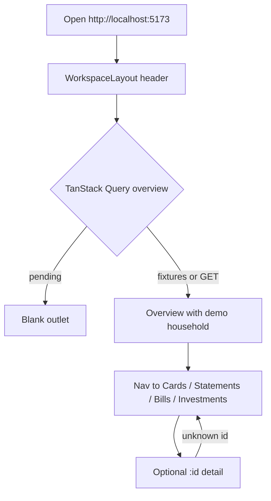
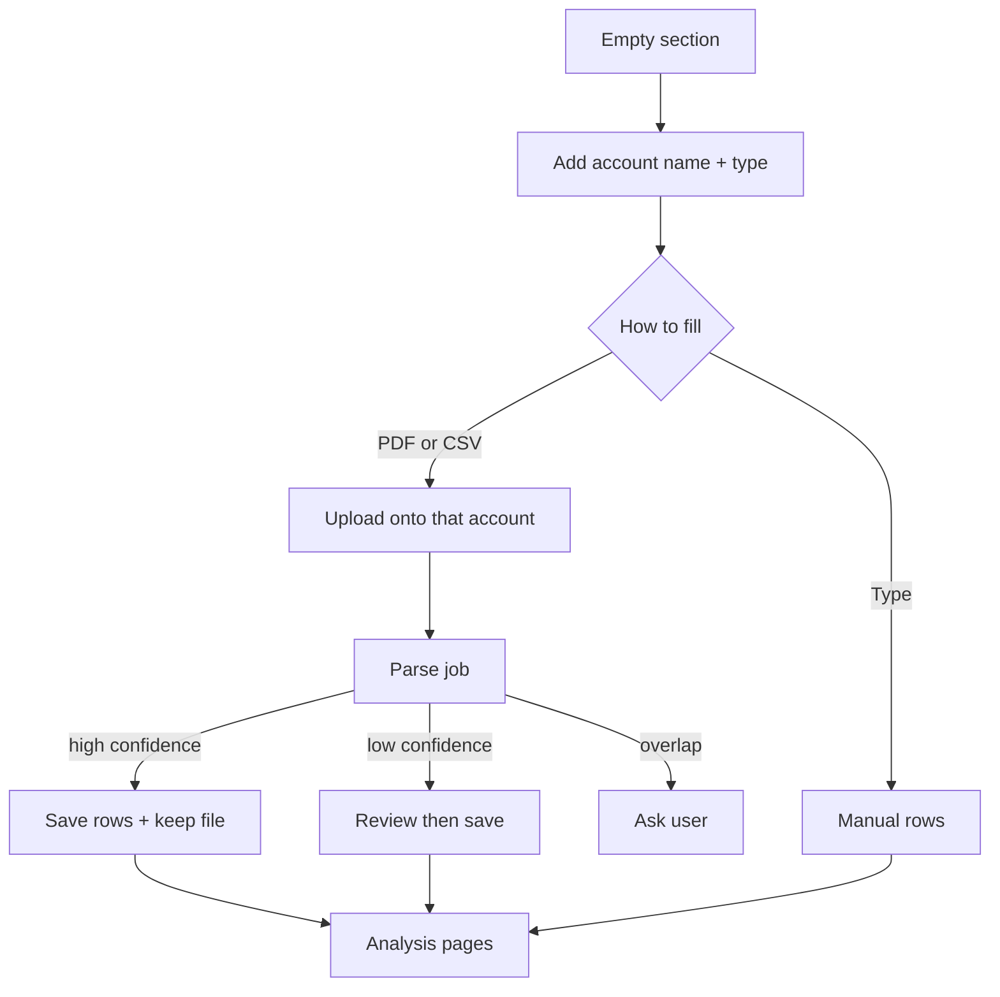

# JH Finance — UI & UX Design Document

> **Product tagline:** _Import financial documents, parse them, and analyze the household in one workspace._

This document describes the **current** UI and UX of the web client (`apps/web`) as implemented. There is no mobile client. Product intent lives in [JH-FINANCE.md](./JH-FINANCE.md). Platform engineering belongs in [WEB.md](./WEB.md). Auth, empty workspaces, add-account, and document upload are **product requirements that the UI does not implement yet**; they appear only in §12.

The web app shares types and demo data with the API via `packages/shared`. Navigation, components, and styling exist only on web.

## Table of Contents

1. [Product Overview](#1-product-overview)
2. [Shared Design Language](#2-shared-design-language)
3. [Information Architecture](#3-information-architecture)
4. [Web](#4-web)
5. [Feature Screens — Detailed UX](#5-feature-screens--detailed-ux)
6. [Current vs intended visual language](#6-current-vs-intended-visual-language)
7. [Design Tokens Reference](#7-design-tokens-reference)
8. [Interaction & Motion Patterns](#8-interaction--motion-patterns)
9. [Empty, Loading & Error States](#9-empty-loading--error-states)
10. [Accessibility Considerations](#10-accessibility-considerations)
11. [Known Gaps & Future UX Work](#11-known-gaps--future-ux-work)
12. [Appendix A: File Reference](#appendix-a-file-reference)
13. [Appendix B: User Flow Diagrams](#appendix-b-user-flow-diagrams)

### 1. Product Overview

JH Finance is a single **workspace**: a desktop-width household ledger. There is no login. Opening the app lands on Overview with a complete demo household already rendered from fixtures. The user browses five sections (Overview, Cards, Statements, Bills, Investments) and drills into account or utility detail pages. Nothing is created, edited, uploaded, or searched.

| Domain | Purpose in the UI today |
| --- | --- |
| Overview | Net worth, allocation, attention, recent activity |
| Cards | Combined spend + per-card statement pages |
| Statements | Bank cash, income vs spending, per-account ledgers |
| Bills | Utilities table, insurance summary cards, upcoming payments |
| Investments | Invested assets + crypto list and per-account pages |

**Offline / optimistic UX:** none. Queries have no optimistic updates. Default `pnpm dev:web` uses in-process fixtures (feels instant). There is no offline banner, retry, or mutation.

### 2. Shared Design Language

#### 2.1 Brand Identity

| Element | Value |
| --- | --- |
| Product name | JH Finance (`WorkspaceLayout`, `index.html` `<title>`) |
| Logo | 28×28px rounded square, `bg-accent` (`#0e6b63`). No wordmark image, no favicon file (`public/` is empty). |
| Tagline | Not shown in the UI. Spec tagline is ingest/analyze; screens do not display it. |
| Primary color | Accent teal `#0e6b63` / `#0E6B63` |
| Ink | `#1a1d21` |
| Canvas | Warm paper `#faf9f5` |
| Type | Inter 400/500/600/700 from Google Fonts |

`packages/shared/src/fixtures.ts` `COLORS` duplicates the same hex values in mixed case for chart slices. CSS tokens in `apps/web/src/index.css` `@theme` are the runtime source for Tailwind classes (`bg-accent`, `text-ink`, …).

#### 2.2 Core UX Principles (as implemented)

1. **One workspace shell.** Every route is a child of `WorkspaceLayout`. No nested layouts, no sidebar, no settings screen.
2. **Browse, don’t mutate.** Primary/ghost buttons are `type="button"` with no `onClick`. There is no `useState` in `apps/web`.
3. **Section → detail.** List pages link to `/:section/:id`. Unknown ids bounce back to the list (`Navigate replace`).
4. **Preformatted money.** Values arrive as strings (`$248,410.52`). `.num` applies tabular figures. The UI does not format with `formatUsd`.
5. **Tone as meaning.** `gain` / `warn` / `loss` color amounts, status pills, attention rows, and flagged table rows.
6. **Demo household is the empty-state substitute.** There is no “No accounts yet.” The first paint is a full October 2026 story for avatar **AM**.
7. **No auth gate.** No login layout, no session, no redirect.

#### 2.3 Authentication UX (Shared)

None.

| Method | Present |
| --- | --- |
| Email/password | ❌ |
| Social | ❌ |
| Magic link | ❌ |
| Guest | The whole app. Avatar chip **AM** is a `div`, not a menu. |

### 3. Information Architecture

#### 3.1 Web route map

From `apps/web/src/app/router.tsx`. No `errorElement`, no splat/404, no login/settings/import routes.

```
/                          OverviewPage
/cards                     CardsPage
/cards/:id                 CardDetailPage
  platinum-4821 | everyday-0937 | travel-2254 | store-7710
/statements                StatementsPage
/statements/:id            BankDetailPage
  checking-0182 | joint-3390 | savings-6617 | hys-1158
/investments               InvestmentsPage
/investments/:id           InvestmentDetailPage
  401k | brokerage-a | brokerage-b | cold-wallet | exchange
/bills                     BillsPage
/bills/:id                 UtilityDetailPage
  electricity | internet | water | gas
```

**Hidden / absent:** insurance has ids (`auto`, `renters`, `health`) but **no routes**. No `/login`, `/import`, `/settings`, `/search`.

**22 screens** = 5 section indexes + 4 cards + 4 banks + 5 investments + 4 utilities.

#### 3.2 Mobile route map

No mobile client.

#### 3.3 Navigation groups

Header-only. Order in code (canonical IA; README prose lists Investments before Bills):

| Group | Path | Web | Notes |
| --- | --- | --- | --- |
| Overview | `/` | ✅ | `end: true` so `/cards` does not stay active |
| Cards | `/cards` | ✅ | |
| Banks | `/statements` | ✅ | Nav label is **Banks**; route stays `/statements` |
| Bills | `/bills` | ✅ | |
| Investments | `/investments` | ✅ | Crypto is not a nav item; crumb on crypto detail says **Crypto** |

Detail breadcrumbs are in `PageHeader`, not in the primary nav.

### 4. Web

| Layer | Choice |
| --- | --- |
| App | Vite 7 + React 19, `apps/web` (`@jh-finance/web`) |
| Routing | `react-router-dom` 7 `createBrowserRouter` |
| Data | TanStack Query 5; `api` from `client-api-sdk` |
| CSS | Tailwind 4 `@tailwindcss/vite`; tokens in `@theme` |
| Charts | Inline SVG (overview sparkline, statements grouped bars, investments donut) + `BarChart` |
| Component library | Local `apps/web/src/components/ui/*` only. No shadcn, no Radix, no icon pack. |

#### Layout shell

Background: `body` `background: var(--color-canvas)` (`#faf9f5`), `color: var(--color-ink)`, `font-size: 14px`, `line-height: 1.4`.

```
+------------------------------------------------------------------+
|  max-w-[1200px] mx-auto  px-8 py-6 pb-12                         |
|  +------------------------------------------------------------+  |
|  | [teal sq] JH Finance   Overview Cards Statements Bills     |  |
|  |                        Investments     [search]  (AM)      |  |
|  | ------------------------ border-b border-line pb-6 ------- |  |
|  +------------------------------------------------------------+  |
|  | <Outlet />  (page: header then metric grid then cards)     |  |
|  +------------------------------------------------------------+  |
+------------------------------------------------------------------+
```

- **No sidebar. No bottom nav.** Header `flex flex-wrap items-center gap-8`.
- Brand: `h-7 w-7 rounded-lg bg-accent` + `text-lg font-bold`.
- Nav: `aria-label="Primary"`, `gap-[22px]`, `text-sm`. Active: `border-b-2 border-accent pb-1.5 font-semibold text-ink`. Inactive: `text-muted`. No hover class.
- Search: `w-[260px] rounded-[10px] border border-line bg-white py-2 pr-3 pl-8`. Prefix glyph `⌕` (U+2315). Placeholder `"Search transactions, holdings"`. Uncontrolled; no submit.
- Avatar: `h-[34px] w-[34px] rounded-full bg-line`, initials **AM**, `aria-label="Account menu"` but not interactive.

#### Page header pattern

`PageHeader` (`components/ui/PageHeader.tsx`):

- Optional crumb: `13px` muted, section link `font-semibold text-accent`, then ` / {current}`.
- Title: `h1` `text-[28px] font-bold tracking-[-0.01em]`.
- Subtitle: `text-sm text-muted`.
- Actions slot, right-aligned (`items-end justify-between`).
- Spacing: `mt-7` on section indexes; `mt-6` when a crumb is present.

**Buttons**

| Component | Classes | Use |
| --- | --- | --- |
| `PrimaryButton` | `rounded-[10px] border-0 bg-accent px-3.5 py-2 text-sm font-medium text-white` | Upload statement, Pay statement, All cards, Move money, Trade, … |
| `GhostButton` | `rounded-[10px] border border-line bg-white px-3.5 py-2 text-sm` | Export CSV, Download statement, card-name chips |

Neither has hover, disabled, or loading styles. Both are inert.

#### Color & typography (web)

See §7. Body 14px Inter. Headings 28px. Hero net worth 44px. Metric values 30/26/24px by size. Captions 13px or 12px.

#### Component patterns

| Pattern | Implementation |
| --- | --- |
| Surface card | `Card`: `rounded-2xl border border-line bg-white`; padding `p-5` / `p-6` / `p-7` |
| Metric tile | `Metric` wraps its own white card (`p-5`); label 13px muted; value `.num font-bold`; hint 13px (inherits gain/warn/loss if those tones) |
| Data table | `DataTable` + `Row` + `Cell`. Uppercase 12px muted headers, `tracking-[0.04em]`. `min-w-[560px]`, horizontal scroll. Flagged row: `bg-loss-bg` |
| Pill | `rounded-full px-2.5 py-0.5 text-xs font-medium` on chip/gain/loss/warn backgrounds |
| Status | `StatusPill` maps copy → tone (e.g. Paid/Ready/Autopay → gain; Flagged → loss; Upcoming/Pending → warn) |
| KV details | `KvList`: muted label, `.num` value, `border-b border-line py-3` |
| Allocation bar | `h-3.5 rounded-full` flex segments; colors from fixture `slice.color` |
| Bar chart | 160px tall; last bar `bg-accent`, others `bg-silver`; `role="img"` |
| Callout | `rounded-xl bg-chip p-3.5` (recurring note, 401(k) drift) |
| Dialog / modal / sheet | **None** |
| Toast | **None** |
| Form / input (working) | **None** besides decorative search/select |

#### Responsive behavior

| Breakpoint | Behavior |
| --- | --- |
| None defined | No `sm:`, `md:`, or `lg:` classes in `apps/web` |
| Viewport meta | `width=device-width, initial-scale=1.0` in `index.html` |
| Grids | Fixed `grid-cols-2`, `3`, `4`, and fractions (`1.45fr_1fr`, `1.4fr_1fr`, …) |
| Wrap | Header, page actions, and some chips use `flex-wrap` |
| Practical | Designed for ~1200px. Phone widths crush 3–4 column metric rows. |

### 5. Feature Screens — Detailed UX

Loading on every page: `if (!data) return null` (blank canvas under the header). Detail `isError` → `Navigate` to the section list. No empty-state strings exist.

#### 5.1 Overview (`/`) — `OverviewPage.tsx`

**Layout**

1. `mt-7` two-column `grid-cols-[1.45fr_1fr] gap-6`: large net-worth card (`padding="lg"`) + 2×2 mini tiles.
2. `mt-6` two-column: Allocation | Needs attention.
3. Full-width Recent activity card.

**Net worth card:** label “Net worth, all accounts”; value `text-[44px]`; change `text-sm font-semibold text-gain`. Range group `aria-label="Time range"`: chips `1M | 3M | 1Y | All` in `bg-chip p-1 rounded-[10px]`. Selected chip (fixture `range === '1Y'`) is `bg-white font-semibold shadow-sm`. **Clicks do nothing.** Sparkline SVG `viewBox="0 0 640 200"`, stroke `#0E6B63` (hardcoded, not `currentColor`), fill opacity 0.08, grid lines `#E3E1D9`.

**Mini tiles** (`Mini`): Cash, Card balances (`text-warn` value), Retirement and brokerage, Crypto (hint `text-loss`). Cash hint is hardcoded `"4 bank accounts"`.

**Needs attention:** list items `flex gap-3 rounded-[10px] p-3` with a 8px tone bar. Backgrounds: `bg-warn-bg` / `bg-loss-bg` / `bg-chip` / `bg-gain-bg`. Four fixture items.

**Activity:** link “View all” → `/statements` (`text-sm font-semibold text-accent`). Gain amounts `text-gain`.

**Search/filter:** range chips only (inert). **Add/edit:** none.

#### 5.2 Credit cards (`/cards`, `/cards/:id`)

**List layout:** `PageHeader` title “Credit cards”, subtitle `"October 2026 · 4 cards · 118 transactions"` (hardcoded; table shows 7 rows). Actions: **All cards** (`PrimaryButton`, inert) + `Link`+`GhostButton` per card name (these **do** navigate).

- Metrics: 3-col — spent, projected, due.
- `grid-cols-[1fr_1.6fr]`: category bars + transactions.
- Category rows: label, amount, `h-2` track `bg-chip`, fill `category.color`.
- Recurring callout: title “Recurring detected”.
- Transaction toolbar: merchant search placeholder `"Search merchants"`; `<select aria-label="Category">` All / Groceries / Dining / Shopping / Travel — **no onChange**.
- Static pills: `1 flagged` (loss), `Pending 2`, `Recurring 8`, `Refunds 1`.
- Flagged row uses `Row flagged` + loss-colored note.

**Detail:** crumb `Cards / {name}`. Actions from fixture: **Download statement** (ghost), **Pay statement** (primary) — inert. Four sm metrics: statement balance (warn), minimum due, credit limit, rewards. `grid-cols-[1.4fr_1fr]`: 6-month `BarChart` | `KvList` card details. Transactions table with `StatusPill`.

**Add/edit/delete:** none. Pay/download: theater.

#### 5.3 Bank statements (`/statements`, `/statements/:id`)

**List:** title “Bank statements”. Actions **Export CSV** | **Upload statement** (inert). Four metrics. `grid-cols-[1.2fr_1fr]`: custom grouped-bar SVG (income `#0E6B63`, spending `#B9BEC8`) | “Where the money went” list. Hardcoded caption: `Oct spending is 6% below the six-month average, driven by lower travel costs.`

- Bank accounts table: name is `Link` `font-semibold` to `bank.href`; statement column `StatusPill`. Pill “4 linked” (leftover copy vs product: import, not link).
- Parsed statement lines table; match column uses `StatusPill` on `row.category`.

**Detail:** crumb “Bank accounts / {name}”. Actions **Export CSV** | **Move money** (inert). Four fixture metrics, 6-month bars, KV details, activity with running balance.

**Add/edit/upload:** none. Upload is the only labeled capture control in the app, and it does not open a file picker.

#### 5.4 Investments and crypto (`/investments`, `/investments/:id`)

**List:** title “Investments and crypto”. Type chips All / 401(k) / Brokerage / Crypto: All is `rounded-full border-accent bg-accent text-white`; others `border-line bg-white`. **No filter state.** Three metrics. Accounts table with **hardcoded share %** by id (67/17/8/6/2). Pill “5 linked, 2 asset types”. Donut SVG `r="72"` stroke 28; center text hardcoded `$205.2k`. Holdings table + 401(k) drift callout.

**Detail:** crumb label `Crypto` if `kind === 'crypto'`, else `Investments`. Actions from fixture (Review rebalance, Trade, Sell shares, Sync now, …) — inert.

- 401(k): mix bars instead of 6-month series; Plan details; Holdings table; extra table “Recent contributions”; drift callout. Empty `activity` → no activity block.
- Brokerage A/B: 6-month bars; holdings; B has vesting `extraTables` (Scheduled/Vested as `StatusPill`).
- Crypto: **no holdings table** (`kind === 'investment'` required). Wallet vs account details heading depends on id.

#### 5.5 Bills and insurance (`/bills`, `/bills/:id`)

**List:** title “Bills and insurance”; **no header actions**. Four metrics. `grid-cols-[1.6fr_1fr]`: utilities table (name `Link` + muted subtitle) | electricity `BarChart`. Then `h2` “Insurance” and **3 unlinked cards** (`grid-cols-3`): name + renewal `Pill`, premium `text-[26px]` + `/mo`. Auto/renters: KV rows. Health: progress bar `h-2 bg-chip` / `bg-accent` plus hardcoded “Out-of-pocket max: `$1,400 of $6,500`” (not on the fixture type). Upcoming payments table.

**Utility detail:** crumb `Bills / {name}`. Actions Pay bill / View bill PDF (or Contact support / Run speed test for internet) — inert. Internet chart titled “Download speed”; others “Usage, {unit}”. Bill history; internet omits usage column.

**Insurance:** summary-only by design. No detail UX.

### 6. Current vs intended visual language

One client, so no cross-platform matrix. Product spec vs shipping UI:

| Concern | Today | Intended ([JH-FINANCE.md](./JH-FINANCE.md)) |
| --- | --- | --- |
| First paint | Full demo household (AM) | Empty workspace |
| Capture | Inert “Upload statement” on Statements only | Add account on each section; upload PDF/CSV onto the account; manual entry anytime |
| Search | Two decorative inputs | Not v1-required |
| Pay / move / trade | Visible primary buttons | Remain non-executing (or be removed) |
| Insurance | Summary cards | Unchanged |
| Density / color | Keep | No redesign in flight; ingest screens should reuse `Card`, `PageHeader`, `PrimaryButton` |
| Mobile | None | None |

New ingest chrome should match existing radii (`10px` controls, `16px` / `rounded-2xl` cards), accent primary buttons, and ghost secondaries — not a second visual language.

### 7. Design Tokens Reference

**Source:** `apps/web/src/index.css` `@theme`. Chart-only duplicates in `packages/shared/src/fixtures.ts` `COLORS`.

#### Semantic colors

| Token | Hex | Tailwind | Use |
| --- | --- | --- | --- |
| canvas | `#faf9f5` | `bg-canvas` (body) | Page background |
| chip | `#f5f4ef` | `bg-chip` | Chip wells, callouts, default pills, muted attention |
| ink | `#1a1d21` | `text-ink` | Body, titles, active nav |
| muted | `#5b6270` | `text-muted` | Subtitles, captions, inactive nav |
| line | `#e3e1d9` | `border-line`, `bg-line` | Borders, avatar fill, chart grid |
| accent | `#0e6b63` | `bg-accent`, `text-accent`, `border-accent` | Logo, active underline, primary buttons, last bar, links |
| gain | `#13794a` | `text-gain` | Positive money, paid/ready |
| warn | `#b54708` | `text-warn` | Dues, upcoming |
| loss | `#b42318` | `text-loss` | Negative / flagged |
| warn-bg | `#fff6e8` | `bg-warn-bg` | Attention + warn pills |
| loss-bg | `#fdf0ee` | `bg-loss-bg` | Flagged rows, loss pills |
| gain-bg | `#eef7f2` | `bg-gain-bg` | Gain pills, gain attention |
| blue | `#2b5ba8` | `bg-blue` (via fixture hex more often) | Allocation slices |
| gold | `#b7791f` | | Allocation |
| purple | `#7a4e9b` | | Allocation |
| silver | `#b9bec8` | `bg-silver` | Non-last bars, spending bars |
| amber | `#d4a24c` | | Crypto slice |

Sparkline and statements SVG stroke/fill often hardcode `#0E6B63` / `#E3E1D9` / `#B9BEC8` / `#5B6270` instead of CSS variables.

#### Spacing (observed)

No spacing scale object. Repeated values: `gap-2` (8px) actions, `gap-4` (16px) metric grids, `gap-6` (24px) major sections, `mt-6` / `mt-7` below header, card padding 20/24/28px (`p-5`/`p-6`/`p-7`), page horizontal `px-8`.

#### Radius

| Role | Class | Approx |
| --- | --- | --- |
| Buttons, search, range well | `rounded-[10px]` | 10px |
| Range inner chip | `rounded-[7px]` | 7px |
| Attention row | `rounded-[10px]` | 10px |
| Pills / type chips | `rounded-full` | pill |
| Cards / metrics | `rounded-2xl` | 16px |
| Callouts | `rounded-xl` | 12px |
| Logo square | `rounded-lg` | 8px |
| Bar tops | `rounded-t-md` | 6px |
| Avatar | `rounded-full` | |

#### Typography scale

| Role | Size / weight |
| --- | --- |
| Body | 14px / 1.4 / Inter |
| Page title | 28px bold, tracking -0.01em |
| Net worth hero | 44px bold, tracking -0.02em |
| Metric lg | 30px bold |
| Metric md | 26px bold |
| Metric sm / mini | 24px (`text-2xl`) bold |
| Section `h2` | 16px (`text-base`) semibold |
| Subtitle / body muted | 14px |
| Caption / crumb / metric label | 13px |
| Chart axis / pills | 12px |
| Table header | 12px medium uppercase, tracking 0.04em |
| Tabular nums | `.num` → `font-variant-numeric: tabular-nums` |

**Dark mode:** none.

### 8. Interaction & Motion Patterns

| Pattern | Web |
| --- | --- |
| Route transitions | None |
| Hover | None on nav, buttons, rows, or links (browser default underline may apply to `<a>`) |
| Focus | Native only; no `focus-visible` classes |
| Dialogs / sheets | None |
| FAB | None |
| Search expand | None (fixed 260px) |
| Haptics | n/a |
| Optimistic UI | None |
| Confirm before action | None (no actions) |
| Charts | Static SVG; not interactive |

### 9. Empty, Loading & Error States

| State | Behavior | User-visible copy |
| --- | --- | --- |
| App boot | Query in flight | **Blank** main (`return null`). Header still shows. |
| Fixture success | Immediate | Full demo household |
| Unknown `/cards/:id` etc. | `isError` → `<Navigate replace>` to section list | No message; URL changes |
| Unknown top-level path | No splat route | React Router blank default |
| Empty accounts | Does not exist | No `No accounts yet.` (or similar) anywhere in `apps/web` |
| Query error on list pages | `data` stays undefined | Blank main (no error UI) |
| Auth error | n/a | — |
| Sign-out | n/a | — |
| Timeout | Query default | Blank / retry none (`OverviewPage.test` sets `retry: false` only in tests) |

Search placeholders (not empty states): `"Search transactions, holdings"`, `"Search merchants"`.

### 10. Accessibility Considerations

**Implemented**

- `html lang="en"`
- Primary `nav aria-label="Primary"`
- Search inputs are real `<input type="search">` (header unlabeled except placeholder; cards merchant field has no `<label>` text besides the glyph)
- Category `<select aria-label="Category">`
- Range `role="group" aria-label="Time range"`
- Card filter group `aria-label="Card"`; investments `aria-label="Account type"`
- Charts: `role="img"` + `aria-label` on sparkline, bar chart, donut, income/spend SVG
- Attention bar `aria-hidden`
- Avatar `aria-label="Account menu"` (misleading: not a menu)
- Table `<th scope="col">`
- Crumb and “View all” are real `<Link>`s
- Status is text in pills, not color-only (color is extra)

**Gaps**

- No skip link, no main landmark (`<main>`)
- Header search has no accessible name beyond placeholder
- Inert buttons are still in the tab order and look actionable
- Time-range and type chips are buttons that do nothing
- No focus rings
- No live region for loading (and loading is blank)
- Color contrast not audited; do not claim WCAG
- Flagged state uses both copy and `bg-loss-bg` (ok) but search/select don’t announce results
- Detail error handling is a silent redirect
- 22px nav gap and 3–4 col grids are not keyboard-documented; no roving tabindex

### 11. Known Gaps & Future UX Work

Incomplete / stub (shipping chrome, no behavior):

- Header search; cards merchant search; cards category select
- Overview range; investments type chips; cards “All cards”
- All `PrimaryButton` / `GhostButton` actions (Pay, Upload, Export, Move money, Trade, Sync, …)
- Account menu **AM**
- Fixture copy “4 linked” / “5 linked” vs import product
- Hardcoded strings: `118 transactions`, share %, `$205.2k`, health OOP max, overview cash hint

Product UX that **does not exist** (required by [JH-FINANCE.md](./JH-FINANCE.md)):

1. Empty workspace (no demo AM on first run)
2. Add account (name/type) on Cards, Statements, Bills, Investments
3. Upload PDF/CSV onto an account (file picker, progress, parse status)
4. Low-confidence parse review
5. Ask-on-overlapping-reimport dialog (no dialog pattern exists yet)
6. Manual create/edit of accounts, transactions, bills, holdings
7. Keep/download original file (“View bill PDF” may later mean this)
8. Insurance remains summary-only (not a gap relative to product)

**Edit-form pattern:** none today. When ingest lands, prefer a full page or `Card` on the account detail (there is no sheet/stack/modal system). Do not invent a mobile FAB.

**Alignment:** n/a (single client). Match new screens to `PageHeader` + `PrimaryButton`/`GhostButton` + `Card` + `DataTable`.

### Appendix A: File Reference

| Concern | Web path |
| --- | --- |
| Root HTML | `apps/web/index.html` |
| Entry / providers | `apps/web/src/main.tsx` (Query + Router only) |
| Router | `apps/web/src/app/router.tsx` |
| App shell | `apps/web/src/layouts/WorkspaceLayout.tsx` |
| Theme / tokens | `apps/web/src/index.css` |
| Chart hex duplicate | `packages/shared/src/fixtures.ts` `COLORS` |
| Tone type | `packages/shared/src/types.ts` `Tone` |
| Page header / buttons | `apps/web/src/components/ui/PageHeader.tsx` |
| Card / Metric / Table / Pill / Status / KV / Bar / Allocation | `apps/web/src/components/ui/*.tsx` |
| Auth gate / login | **None** |
| Settings store | **None** |
| Logo asset | CSS square only; `apps/web/public/` empty |
| API wiring | `apps/web/src/api/client.ts` |

### Appendix B: User Flow Diagrams

**Authentication:** not implemented. Current boot:



**Capture / create (not implemented).** Product-intended flow for when ingest exists:



*Document generated from codebase review of `apps/web/src` (layout, pages, `components/ui`, `index.css`) and `packages/shared` tokens/fixtures. Last updated: 26 Oct 2026.*
